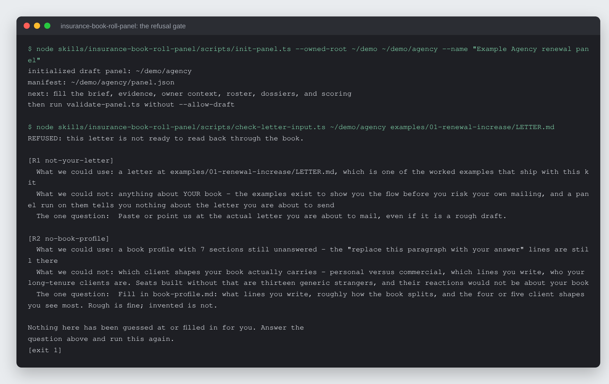
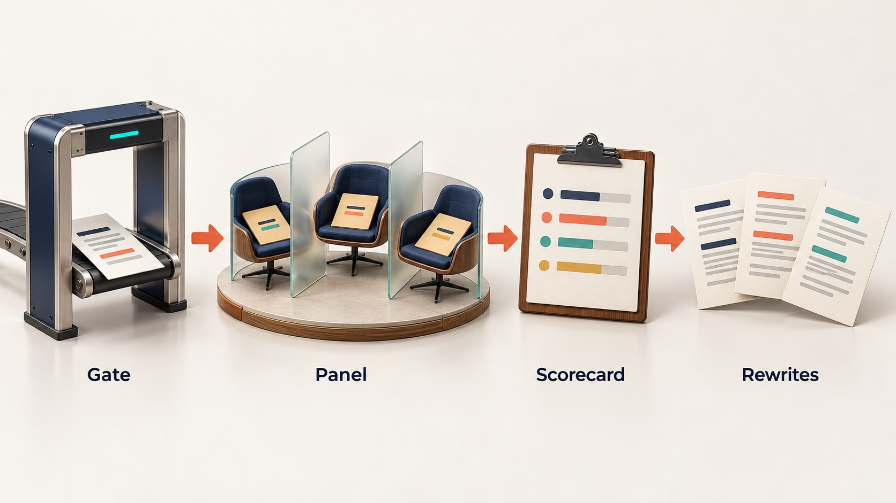

# Insurance Book-Roll Panel

Let an independent insurance agency read a renewal, cross-sell or book-roll
letter through thirteen researched policyholder composites before it goes to
the whole book.


-3178c6)


## What it is

A portable AI kit for independent insurance agencies. The agency's letter goes
in. Thirteen dossier-backed policyholder seats read it independently and say
whether they would call back, stay, or start shopping. A weighted rubric scores
the letter, a synthesis step combines the reactions without erasing dissent,
and three rewrites are tested the same way. The agency's producers and account
managers keep every decision; the panel shows them the objections before the
mailing does.



*A real run: `init-panel.ts` creates a draft workspace, then the refusal gate
`check-letter-input.ts` refuses to proceed because the letter is a shipped
example and the book profile is still blank. The scratch folder is shown as
`~/demo`; nothing else is edited.*

## Why it exists

A renewal or book-roll letter goes to the whole book at once. Mailing it is an
expensive way to find out how it reads, and the feedback arrives as
non-renewals. Testing it properly first, by recruiting policyholders in the
right lines and interviewing them, is a research project a small agency does
not commission before a mailing.

| | Commissioned policyholder research | This kit |
| --- | --- | --- |
| Turnaround | weeks | one sitting |
| Who reads the letter | real policyholders | researched composites |

The second row does not favour the kit. These are composites, not the agency's
actual policyholders, and the kit does not predict retention. It gives the
agency's staff an early, structured read so their own judgment has more to
work with.

## How it works



The kit is the insurance version of a general synthetic customer panel. The
runner, scoring engine, rubric machinery, seat contracts and validators are
reused unchanged; the insurance layer (thirteen seat shapes, letter-input
rules, workflows) is new. A deterministic TypeScript gate,
`check-letter-input.ts`, checks the input before any AI work starts. Each seat
then reads the same letter in its own fresh context, and a synthesis step and a
frozen scorecard combine the reactions. `room.sh` manages named rooms: build
the panel once from the agency's book, then `clean` resets it for the next
letter, archiving rather than deleting.

## Features

- **A script-enforced refusal.** The kit stops when there is no letter of the
  agency's own (R1), no filled-in book profile (R2), or a premium change with
  no number and no reason (R3, unless the agency says the omission is
  deliberate). Each refusal prints what was read, what was not, and the one
  question that unblocks it. It never invents a premium, carrier or date.
- **Two dissent seats by design.** A client who is leaving regardless and a
  wrong cross-sell target. A "yes" from the wrong-fit seat is reported as a
  failure, not a win.
- **Own-data verification.** Install is not complete until one of the agency's
  own letters has gone through end to end; the shipped examples never count.
- **Honest execution records.** `RUN.json` records the tier and execution mode
  that actually ran (parallel, isolated-sequential or shared-context).
- **Works across AI apps.** T1 (subagents) runs seats in parallel, T2 (shell
  only) runs them one by one in fresh contexts, T3 (chat only) degrades to
  checklists and says so.
- **Room lifecycle in plain bash 3.2.** Runs on a stock Mac with nothing
  installed.
- **Insurance boundaries.** No coverage, pricing, licensing or compliance
  determinations, and no policyholder identifiers in any run packet.
- **Worked examples.** A complete renewal-increase run (letter, five seat
  reactions shown, synthesis, scorecard, result) and a refusal walkthrough
  under `examples/`.

## Run it locally (for review)

Requires Node 22.18 or newer. The buyer path needs no `npm install`; the
typecheck needs the declared dev dependencies.

```bash
npm test                     # behaviour suite: panel spine, refusal gate, room lifecycle
npm install && npm run check # typecheck, then the suite
node skills/insurance-book-roll-panel/scripts/check-letter-input.ts <workspace> <letter.md>
```

Test scratch folders default to the operating system's temporary directory and
can be moved with `BOOK_ROLL_TEST_SCRATCH_ROOT` and
`BOOK_ROLL_TEST_ARCHIVE_ROOT`.

Licence: free for personal and non-commercial use with credit; commercial use
needs a licence. See `LICENSE` (PolyForm Noncommercial 1.0.0) or write to
rico@rtech-consulting.com.

## How it was built

Built in one day in August 2026 on top of an existing panel kit, then tested
by AI agents playing three invented agencies, which found that the refusal gate
missed the exact letter it existed to catch. The dated story is in
[docs/BUILD-STORY.md](docs/BUILD-STORY.md).

## Project status

Experimental, version 0.2.3. Built and self-tested; never run against a real
agency letter and never checked on a real device by a person. `ACCEPTANCE.md`
lists what is done and what is not. At this snapshot 30 of 32 tests pass: the
two installed-integrity tests fail because folder README files added on
2026-08-24 are not yet in the payload's integrity record
(`KIT-METADATA.json`).

## Credits

The panel workflow follows the synthetic focus-group method shown in Corey
Ganim's interview with Justin Brooke (credited in the parent panel kit).
Agency-size data in `references/book-seat-shapes.md` is from US Census County
Business Patterns.

## Author

Rico Rojas, https://rico-rojas.com
