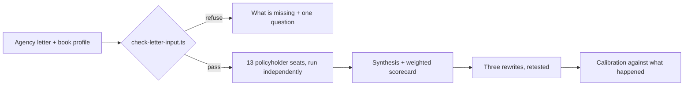

# Insurance Book-Roll Panel Kit

A portable AI kit that lets an independent insurance agency test a renewal,
cross-sell or book-roll letter on a panel of researched policyholder composites
before it goes to the whole book.

> Portfolio piece. Source shown for review only; not licensed for use. See LICENSE.

## What it does

The agency's letter goes in. Thirteen dossier-backed policyholder seats read it
independently and say whether they would call back, stay, or start shopping. A
weighted rubric scores the letter, the reactions are synthesized without
erasing dissent, and three rewrites are tested the same way. The agency's
producers and account managers keep every decision; the panel gives them the
objections early.

## The problem

A renewal or book-roll letter goes to the whole book at once. Finding out how it
landed by mailing it is the expensive way, and the feedback arrives as
non-renewals. Testing it properly first (recruiting policyholders in the right
lines, moderating, writing it up) is a research project no small agency
commissions before a mailing.

| | Commissioned policyholder research | This kit |
| --- | --- | --- |
| Cost | roughly $20,000 and up | a few dollars of model usage |
| Turnaround | weeks | about ten minutes |
| What you get | real policyholders | researched composites |

Both figures are internal estimates, not measured results. The last row does
not favor the kit: these are composites, not the agency's actual policyholders.
It does not predict retention.

## How it works

The kit is a re-skin of a general synthetic customer panel: the runner, scoring
engine, rubric machinery, seat contracts and validators are reused, and only the
insurance layer (seat shapes, letter-input rules, workflows) is new. A
deterministic TypeScript gate checks the input before any AI work starts. Each
seat runs in its own fresh context against the same letter, then a synthesis
step and a frozen scorecard combine the reactions. `room.sh` manages named
rooms: build the panel once from the agency's book, then `clean` resets it for
the next letter, archiving rather than deleting.



## Features

- **A script-enforced refusal.** The kit stops when there is no letter of the
  agency's own, no filled-in book profile, or a premium change with no number
  and no reason (unless the agency says it is deliberately omitted). Each
  refusal prints what was read, what was not, and the one question that
  unblocks it.
- **Own-data verification.** Install is not complete until one of the agency's
  own letters has gone through end to end; the shipped examples never count.
- **Honest execution records.** `RUN.json` records the tier and execution mode
  that actually ran (parallel, isolated-sequential, or shared-context).
- **Harness-agnostic tiers.** T1 (subagents and workflows) runs seats in
  parallel, T2 (shell only) runs them sequentially in fresh contexts, T3 (chat
  only) degrades to checklists and says so.
- **Room lifecycle in plain bash 3.2.** Works on a stock Mac with nothing
  installed.
- **Worked examples.** One complete renewal-increase run and one refusal
  walkthrough under `examples/`.

## Stack

TypeScript run directly by Node 22.18+ (no build step, no `npm install` for the
operator), bash for the room lifecycle, Markdown skill and workflow files,
JSON Schema for the kit manifest, `node --test` for the behavior suite.

## Status

Experimental (v0.2.3). Built and self-tested; never run against a real agency
letter and never device-checked by a human. `ACCEPTANCE.md` lists what is done
and what is not.

## Running it locally (for reviewers)

```text
npm install && npm run check
```

Runs the typecheck and the behavior suite (panel spine, refusal gate, room
lifecycle). Test case folders default to the OS temporary directory and are
overridable with `BOOK_ROLL_TEST_SCRATCH_ROOT` / `BOOK_ROLL_TEST_ARCHIVE_ROOT`.

## Screenshots

None.

## Author

Rico Rojas, rico@rtech-consulting.com, https://rico-rojas.com
